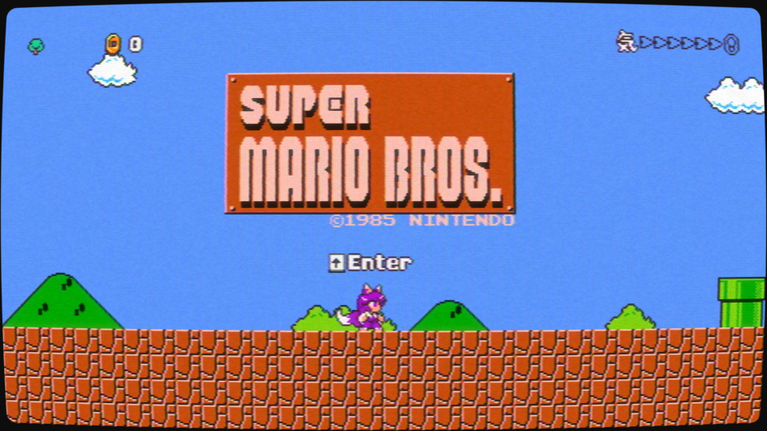

# Kitsune Tails: Super Kitsune Bros

An attempt at a faithful recreation of [Super Mario Bros](https://en.wikipedia.org/wiki/Super_Mario_Bros) in [Kitsune Tails](https://kitsunegames.com/kitsunetails/).



## Features

This includes all eight worlds. If you'd like to help improve it, feel free to get involved.

- [x] World 1
- [x] World 2
- [x] World 3
- [x] World 4
- [x] World 5
- [x] World 6
- [x] World 7
- [x] World 8
- [x] World select after beating 8-4, with a pipe into each world
- [x] Halfway checkpoints where SMB has them
- [x] Bowser's bridge collapses when you reach the axe
- [x] Falling lifts and springboard lifts that wait for you

## Installation

Subscribe to [Super Kitsune Bros on the Steam Workshop](https://steamcommunity.com/sharedfiles/filedetails/?id=3320203878), or install it manually...

1. Download `SuperKitsuneBros.zip` from the [latest release](https://github.com/RobLoach/SuperKitsuneBros/releases/latest)
2. Extract it to your `KitsuneTails/levels` folder, usually available at one of the following...
    ```
    AppData\Roaming\KitsuneTails\levels
    $XDG_DATA_HOME/KitsuneTails/levels
    ~/Library/Application Support/KitsuneTails/levels
    ~/.local/share/KitsuneTails/levels
    ~/.var/app/com.valvesoftware.Steam/data/KitsuneTails/levels
    ```

    The result should appear like `KitsuneTails/levels/SuperKitsuneBros/level.json`
  
3. Launch Kitsune Tails
4. Select Mods
5. Choose SuperKitsuneBros

## Development

1. Have [Node.js](https://nodejs.org/en) 22.12 or newer installed
1. Clone project to your levels dir (from above)
    ``` sh
    git clone https://github.com/RobLoach/SuperKitsuneBros.git ~/.local/share/KitsuneTails/levels/SuperKitsuneBros
    ```
    On Windows...
    ``` cmd
    git clone https://github.com/RobLoach/SuperKitsuneBros.git %APPDATA%\KitsuneTails\levels\SuperKitsuneBros
    ```
1. For Steam installed Kitsune, run...
    ```
    npm it
    ```
1. For non-Steam install (itch, etc), run...
    ```
    npm i
    npm t /WHEREVER/KITSUNE/IS/INSTALLED
    ```
1. Open `SuperKitsuneBros.tiled-project` with [Tiled](https://www.mapeditor.org/)
1. See the newly created `deps` directory for example levels from Kitsune Tails as well as the modding documentation
1. Run `npm run lint` to check the maps for broken links and bad data
1. To remove the downloaded dependencies, run `npm run clean`
1. To publish a new version, push a `v*` tag. GitHub Actions builds `SuperKitsuneBros.zip` with `npm run package` and attaches it to the release. `npm run package` copies `tools/screenshot.jpg` to `../SuperKitsuneBros.jpg` as the 16:9 Workshop preview, then deletes all the development files, including `.git`, so only run it locally in a separate clone
1. To update the [Steam Workshop item](https://steamcommunity.com/sharedfiles/filedetails/?id=3320203878)...
    1. Extract the release's `SuperKitsuneBros.zip` into your levels folder, in place of your clone. Only mods there can be uploaded. The zip includes the `SuperKitsuneBros.jpg` preview image, which lands next to the `SuperKitsuneBros` folder
    1. In Kitsune Tails, select the mod in the Mods menu and press the menu3 button to upload it

## File Descriptions

| Filename | Description |
| -------- | ----------- |
| bg-*.json | Background
| level-*.json | A map used in Super Kitsune Bros
| level.json | The opening welcome screen for the game
| music-*.ogg | Music for the game |
| tileset.png | Additional decoration tileset from the original game
| SuperKitsuneBros.tiled-project | Tiled project file
| tools | Various tools to aid development

## Resources

- https://nesmaps.com/maps/SuperMarioBrothers/SuperMarioBrothers.html
- https://www.mariowiki.com/Super_Mario_Bros.#Worlds_and_levels
- https://downloads.khinsider.com/game-soundtracks/album/super-mario-bros
- https://nu.vgmtreasurechest.com/soundtracks/super-mario-bros/vfsuvvoj/18.%20Saved%20the%20Princess%20%28NES%29%20%5BVS.%20Super%20Mario%20Bros.%5D.mp3
- https://fontstruct.com/fontstructions/show/1332355/arcade-classic-2-19

## License

[CC BY-NC-SA 4.0](https://creativecommons.org/licenses/by-nc-sa/4.0/).
